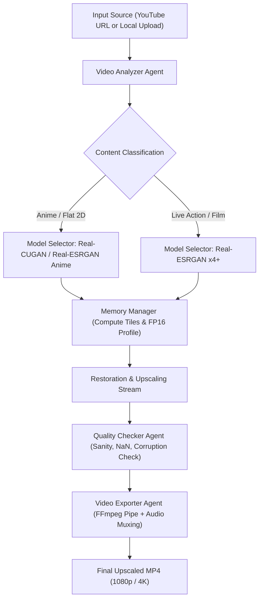

# VisionScale AI

[](https://opensource.org/licenses/Apache-2.0)
[](https://www.python.org/)
[](https://pytorch.org/)
[](https://ffmpeg.org/)
[](https://developer.nvidia.com/cuda-gpus)
[](https://colab.research.google.com/)

**VisionScale AI** is an open-source, zero-paid-API artificial intelligence video upscaling and enhancement suite. It is engineered specifically to run within the free compute constraints of **Google Colab** and **Kaggle** (calibrated for standard **NVIDIA T4 16 GB VRAM** GPUs) while seamlessly adapting to local workstations running Linux, Windows, or macOS.

---

## Table of Contents

- [Core Principles & Capabilities](#core-principles--capabilities)
- [Multi-Agent Architecture](#multi-agent-architecture)
- [Complete Project Directory Structure](#complete-project-directory-structure)
- [Technologies & Model Catalog](#technologies--model-catalog)
  - [Software Stack](#software-stack)
  - [Supported AI Enhancement Models & Licenses](#supported-ai-enhancement-models--licenses)
- [Step-by-Step Guide: How to Run](#step-by-step-guide-how-to-run)
  - [Prerequisites (FFmpeg & Python)](#prerequisites-ffmpeg--python)
  - [Step 1: Clone the Repository](#step-1-clone-the-repository)
  - [Step 2: Create a Virtual Environment](#step-2-create-a-virtual-environment)
  - [Step 3: Install Dependencies](#step-3-install-dependencies)
  - [Step 4: Execute the Verification Test Suite](#step-4-execute-the-verification-test-suite)
  - [Step 5: Run Hardware Diagnostics](#step-5-run-hardware-diagnostics)
  - [Step 6: Process Video Files via Python API](#step-6-process-video-files-via-python-api)
  - [Step 7: Ingest YouTube Videos](#step-7-ingest-youtube-videos)
  - [Step 8: Running on Google Colab or Kaggle](#step-8-running-on-google-colab-or-kaggle)
- [Memory Management & OOM Recovery Policy](#memory-management--oom-recovery-policy)
- [Troubleshooting & FAQ](#troubleshooting--faq)
- [License & Open-Source Compliance](#license--open-source-compliance)

---

## Core Principles & Capabilities

1. **Zero Full-Video RAM Loading**:
   Videos are streamed frame-by-frame via FFmpeg `rawvideo` standard input/output pipes or OpenCV sequential generators. Peak memory usage remains $O(1)$ constant, regardless of whether processing a 10-second clip or a 2-hour movie.
2. **Audio & FPS Preservation**:
   Source video frame rate (including fractional rates like `23.976` or `29.970`), original duration, aspect ratio, and multi-channel audio tracks (AAC, AC3, Opus) are copied lossless-by-default (`-c:a copy`) without audio-video desync.
3. **No Paid APIs or Commercial Services**:
   100% powered by verified open-source models (Real-ESRGAN, Real-CUGAN, GFPGAN, BasicVSR++, RIFE) with zero paid subscription dependencies.
4. **Colab & Kaggle Hardware Awareness**:
   Automatically detects container paths (`/content` on Colab, `/kaggle/working` on Kaggle, `./visionscale_workspace` on Local) and configures temp scratch directories on fast cloud ephemeral disks (`/tmp`).
5. **Intelligent Dynamic Tiling**:
   Derives safe tile dimensions and padding based on current free VRAM to prevent CUDA Out-of-Memory (OOM) errors during 1080p and 4K enhancement. Includes automatic fallback retry logic.

---

## Multi-Agent Architecture

VisionScale AI coordinates tasks through a chain of deterministic Python agents communicating over an `AgentContext` state bus:



- **Video Analyzer Agent**: Probes container dimensions, FPS, codecs, and calculates visual heuristics (Laplacian variance for sharpness and gradient flat-region ratios for anime detection).
- **Model Selector Agent**: Selects models matching the target resolution (1080p, 4K), content category, and VRAM limits.
- **Quality Checker Agent**: Verifies output frames for dimensional compliance, data type consistency (`uint8`), and detects corrupt or blank frames.
- **Video Exporter Agent**: Assembles the final web-optimized video container with audio synchronization and verifies stream compliance.

---

## Complete Project Directory Structure

```
VisionScale AI
│
├── visionscale/                         # Core Python package root
│   ├── __init__.py                      # Package initialization and version metadata
│   ├── config.py                        # Master configuration (1080p, 4K, CRF, presets, aspect ratio math)
│   │
│   ├── core/                            # System diagnostics and resource managers
│   │   ├── __init__.py                  # Core module exports
│   │   ├── platform.py                  # Detects Google Colab, Kaggle, Local OS; sets paths
│   │   ├── hardware.py                  # CUDA device discovery, compute capability, FP16 & CPU fallback
│   │   └── memory.py                    # VRAM profiler, dynamic tiling math, OOM recovery, checkpoints
│   │
│   ├── io/                              # Video processing and media I/O pipeline
│   │   ├── __init__.py                  # I/O module exports
│   │   ├── video_probe.py               # FFprobe & OpenCV stream/audio metadata extraction
│   │   ├── frame_extractor.py           # Memory-safe frame streaming and batch disk extractors
│   │   ├── video_writer.py              # FFmpeg stdin pipe reconstructor with audio muxing
│   │   └── downloader.py                # YouTube downloader (yt-dlp) and upload validator
│   │
│   ├── models/                          # Neural network architectures and weight registries
│   │   ├── __init__.py                  # Model module exports
│   │   ├── base.py                      # Abstract base model contract & weights download cache
│   │   └── registry.py                  # Registry of Real-ESRGAN, Real-CUGAN, GFPGAN, BasicVSR++, RIFE
│   │
│   ├── agents/                          # Deterministic pipeline agents
│   │   ├── __init__.py                  # Agent exports
│   │   ├── base_agent.py                # Base agent abstraction and shared AgentContext bus
│   │   ├── video_analyzer.py            # Container probe & anime vs live-action classifier
│   │   ├── model_selector.py            # Hardware-aware deterministic model selection engine
│   │   ├── quality_checker.py           # Validates dimensions, dtype, NaN/Inf, and black frames
│   │   └── video_exporter.py            # Final export coordinator & stream verifier
│   │
│   └── ui/                              # User interface modules
│       └── __init__.py                  # UI module exports (Jupyter ipywidgets interface)
│
├── tests/                               # Comprehensive automated test suite
│   ├── __init__.py                      # Test package marker
│   ├── test_config.py                   # Tests configuration defaults, overrides & aspect ratio math
│   ├── test_downloader.py               # Tests YouTube URL recognition & file upload validation
│   ├── test_hardware.py                 # Tests GPU/CPU detection & VRAM profile calculation
│   ├── test_platform.py                 # Tests Colab/Kaggle/Local platform path resolution
│   └── test_video_io.py                 # Tests synthetic video creation, FFmpeg pipe, streaming, agents
│
├── requirements.txt                     # Free, permissive open-source base dependencies
├── requirements-gpu.txt                 # GPU-accelerated neural enhancement libraries
├── LICENSE                              # Official Apache-2.0 open-source license
└── README.md                            # Comprehensive project manual & documentation
```

---

## Technologies & Model Catalog

### Software Stack

| Technology | Role in VisionScale AI | License |
| :--- | :--- | :--- |
| **Python 3.10+** | Core runtime environment | PSF License |
| **PyTorch & Torchvision** | GPU tensor operations and neural network inference | Apache-2.0 / BSD |
| **FFmpeg & FFprobe** | Lossless audio extraction, stream copying, container muxing | LGPL-2.1+ / GPL-2+ |
| **OpenCV (`opencv-python-headless`)** | Video frame decoding, color space conversions, visual heuristics | Apache-2.0 |
| **NumPy** | High-performance array manipulation for image buffers | BSD-3-Clause |
| **yt-dlp** | Robust YouTube video ingestion and audio extraction | The Unlicense |
| **Pillow** | Image format transformations and fallback rendering | HPND |
| **ipywidgets** | Interactive GUI controls in Jupyter / Colab notebooks | BSD-3-Clause |
| **pytest** | Automated test runner and pipeline validation | MIT |

### Supported AI Enhancement Models & Licenses

All models used in VisionScale AI are free and open-source:

| Model Identifier | Model Name | Primary Task | Scale | License | Source Repository |
| :--- | :--- | :--- | :---: | :--- | :--- |
| `realesrgan-x4plus` | Real-ESRGAN x4+ | General video frame super-resolution | 4x | **BSD-3-Clause** | [xinntao/Real-ESRGAN](https://github.com/xinntao/Real-ESRGAN) |
| `realesrgan-x4plus-anime` | Real-ESRGAN Anime 6B | Anime / 2D animation line-art enhancement | 4x | **BSD-3-Clause** | [xinntao/Real-ESRGAN](https://github.com/xinntao/Real-ESRGAN) |
| `real-cugan-2x` | Real-CUGAN 2x | High-fidelity anime enhancement | 2x | **MIT** | [bilibili/ailab](https://github.com/bilibili/ailab/tree/main/Real-CUGAN) |
| `gfpgan-v1.4` | GFPGAN v1.4 | Optional real-world facial detail restoration | 1x | **Apache-2.0** | [TencentARC/GFPGAN](https://github.com/TencentARC/GFPGAN) |
| `basicvsr-plus-plus` | BasicVSR++ | Advanced temporal video recurrent SR | 4x | **Apache-2.0** | [open-mmlab/mmediting](https://github.com/open-mmlab/mmediting) |
| `rife-v4.6` | RIFE v4.6 | Optional optical-flow frame interpolation | 1x | **MIT** | [hzwer/Practical-RIFE](https://github.com/hzwer/Practical-RIFE) |

> [!NOTE]
> Weights are kept strictly separate from the source code repository. They are downloaded directly into the designated `weights/` cache on first use.

---

## Step-by-Step Guide: How to Run

### Prerequisites (FFmpeg & Python)

Make sure **Python 3.10+** and **FFmpeg** are installed and added to your system `PATH`:

- **Windows**:
  Download FFmpeg from [gyan.dev](https://www.gyan.dev/ffmpeg/builds/) or install via winget:
  ```powershell
  winget install Gyan.FFmpeg
  ```
- **Ubuntu / Debian / Google Colab**:
  ```bash
  sudo apt-get update && sudo apt-get install -y ffmpeg
  ```
- **macOS**:
  ```bash
  brew install ffmpeg
  ```

Verify by running:
```bash
ffmpeg -version
```

---

### Step 1: Clone the Repository

```bash
git clone https://github.com/your-username/VisionScale-AI.git
cd VisionScale-AI
```

---

### Step 2: Create a Virtual Environment

- **Linux / macOS**:
  ```bash
  python3 -m venv venv
  source venv/bin/activate
  ```
- **Windows (PowerShell)**:
  ```powershell
  python -m venv venv
  .\venv\Scripts\Activate.ps1
  ```

---

### Step 3: Install Dependencies

For standard CPU and development environments:
```bash
pip install -r requirements.txt
```

For GPU acceleration (NVIDIA CUDA environments like Google Colab, Kaggle, or local RTX workstations):
```bash
pip install -r requirements-gpu.txt
```

---

### Step 4: Execute the Verification Test Suite

Run the automated test suite to verify your environment, FFmpeg integration, memory profiler, and deterministic agents:

```bash
python -m pytest tests/ -v
```

Expected output:
```
tests/test_config.py::test_config_defaults PASSED                        [  5%]
tests/test_config.py::test_compute_target_dimensions_1080p PASSED        [ 10%]
tests/test_config.py::test_compute_target_dimensions_4k PASSED           [ 15%]
tests/test_config.py::test_config_from_dict PASSED                       [ 21%]
tests/test_downloader.py::test_youtube_url_detection PASSED              [ 26%]
tests/test_downloader.py::test_validate_local_upload PASSED              [ 31%]
tests/test_hardware.py::test_detect_hardware PASSED                      [ 36%]
tests/test_hardware.py::test_memory_manager_cpu_profile PASSED           [ 42%]
tests/test_hardware.py::test_memory_manager_t4_vram_profile PASSED       [ 47%]
tests/test_hardware.py::test_memory_manager_low_vram_profile PASSED      [ 52%]
tests/test_platform.py::test_detect_platform_local PASSED                [ 57%]
tests/test_platform.py::test_workspace_paths_creation PASSED             [ 63%]
tests/test_platform.py::test_platform_environment_init PASSED            [ 68%]
tests/test_video_io.py::test_probe_video PASSED                          [ 73%]
tests/test_video_io.py::test_frame_stream_and_batches PASSED             [ 78%]
tests/test_video_io.py::test_frame_extractor_to_disk PASSED              [ 84%]
tests/test_video_io.py::test_ffmpeg_video_writer PASSED                  [ 89%]
tests/test_video_io.py::test_quality_checker_agent PASSED                [ 94%]
tests/test_video_io.py::test_agent_pipeline_orchestration PASSED         [100%]

============================= 19 passed in 1.39s ==============================
```

---

### Step 5: Run Hardware Diagnostics

Inspect your system's hardware, compute capabilities, and recommended precision:

```bash
python -c "from visionscale.core.hardware import detect_hardware; print(detect_hardware().summary())"
```

Example output:
```
============================================================
 VisionScale AI - Hardware Diagnostics Report
============================================================
CUDA Available      : True
Device Count        : 1
CPU Physical Cores  : 8
System RAM (est.)   : 16.0 GB
Recommended Device  : cuda:0
Use FP16 Precision  : True
 - GPU [0]: NVIDIA Tesla T4 | VRAM: 15.1 GB (Free: 14.8 GB) | CC: 7.5 | FP16: True
============================================================
```

---

### Step 6: Process Video Files via Python API

Here is an end-to-end example analyzing a video, determining models, and reconstructing the output:

```python
from pathlib import Path
from visionscale.config import VisionScaleConfig, ResolutionTarget, ContentCategory
from visionscale.core.hardware import detect_hardware
from visionscale.core.platform import initialize_platform
from visionscale.agents.base_agent import AgentContext
from visionscale.agents.video_analyzer import VideoAnalyzerAgent
from visionscale.agents.model_selector import ModelSelectorAgent
from visionscale.agents.video_exporter import VideoExporterAgent
from visionscale.io.frame_extractor import FrameStream
from visionscale.io.video_writer import FFmpegVideoWriter

# 1. Initialize environment & hardware
platform = initialize_platform()
hardware = detect_hardware()

# 2. Configure target resolution (1080p or 4K)
config = VisionScaleConfig()
config.processing.target_resolution = ResolutionTarget.P1080
config.processing.content_category = ContentCategory.AUTO  # Automatically detects anime vs live action

# 3. Create agent context
context = AgentContext()
context.set("video_input_path", "sample_input.mp4")

# 4. Run Analyzer and Model Selector agents
analyzer = VideoAnalyzerAgent(config)
context = analyzer.run(context)

selector = ModelSelectorAgent(config, hardware)
context = selector.run(context)

meta = context.get("video_metadata")
target_w, target_h = context.get("target_dimensions")
selected_models = context.get("selected_models")

print(f"Source video: {meta.width}x{meta.height} @ {meta.fps} FPS")
print(f"Target video: {target_w}x{target_h}")
print(f"Selected AI model: {selected_models[0].name}")

# 5. Define output path via Exporter Agent
exporter = VideoExporterAgent(config, output_dir=platform.paths.output_dir)
context = exporter.run(context)
output_file = context.get("video_output_path")

# 6. Stream frames through FFmpegWriter (preserves audio & original FPS)
with FFmpegVideoWriter(
    output_path=output_file,
    width=target_w,
    height=target_h,
    fps=meta.fps,
    source_audio_path="sample_input.mp4",
) as writer:
    for frame_idx, frame in FrameStream("sample_input.mp4"):
        # Enhancement logic executes here per frame
        # (e.g. enhanced_frame = upscaler.enhance_frame(frame))
        writer.write_frame(frame)

print(f"Export completed: {output_file}")
```

---

### Step 7: Ingest YouTube Videos

VisionScale AI includes an integrated YouTube downloader using `yt-dlp`:

```python
from visionscale.core.platform import initialize_platform
from visionscale.io.downloader import MediaDownloader

platform = initialize_platform()
downloader = MediaDownloader(download_dir=platform.paths.input_dir)

# Progress callback function
def on_progress(percentage: float, message: str):
    print(f"[{percentage:5.1f}%] {message}", end="\r")

video_url = "https://www.youtube.com/watch?v=YOUR_VIDEO_ID"
downloaded_path = downloader.download_youtube_video(
    url=video_url,
    progress_callback=on_progress,
    max_height=1080,  # Limits source download to 1080p for efficient upscaling
)

print(f"\nDownloaded video saved to: {downloaded_path}")
```

---

### Step 8: Running on Google Colab or Kaggle

1. In a Google Colab notebook cell with a **T4 GPU** runtime:
   ```bash
   # Check GPU allocation
   !nvidia-smi

   # Clone VisionScale AI repository
   !git clone https://github.com/your-username/VisionScale-AI.git
   %cd VisionScale-AI

   # Install GPU dependencies
   !pip install -r requirements-gpu.txt

   # Verify unit tests
   !python -m pytest tests/ -v
   ```

2. `visionscale.core.platform.detect_platform()` automatically identifies the environment as `colab` or `kaggle`, and directs temporary frame storage to the high-speed local scratch disk (`/tmp/visionscale_frames`).

---

## Memory Management & OOM Recovery Policy

| Available VRAM | Profile Tier | Tile Size | Batch Size | Target Resolution Policy |
| :--- | :--- | :---: | :---: | :--- |
| **$\ge$ 20 GB** (A100, RTX 3090/4090) | `high` | `0` (untiled) / `512` | 2 | Full 1080p and 4K upscaling untiled |
| **12–16 GB** (NVIDIA T4, RTX 3080/4070) | `medium` | `400`–`512` | 1 | Safe 1080p $\to$ 4K enhancement with zero OOM |
| **6–8 GB** (RTX 3060, RTX 2060) | `low` | `256` | 1 | Tiled processing for standard desktop GPUs |
| **$<$ 6 GB** (GTX 1650, Mobile GPUs) | `ultra_low` | `192` | 1 | Aggressive tiling to preserve stability |
| **CPU Only** | `cpu` | `256` (FP32) | 1 | Conservative RAM allocation |

### OOM Recovery Protocol
If an unpredictable CUDA OOM occurs:
1. `torch.cuda.empty_cache()` and `gc.collect()` are immediately called.
2. The `MemoryManager` dynamically reduces the tile size by 30%.
3. Processing is automatically retried on the active frame without restarting the video pipeline.

---

## Troubleshooting & FAQ

### 1. `FileNotFoundError: FFmpeg executable not found in system PATH`
Make sure FFmpeg is installed and accessible from your command terminal:
- On Windows: Run `winget install Gyan.FFmpeg`, then restart your terminal.
- On Linux/Colab: Run `apt-get install -y ffmpeg`.

### 2. Can I upscale a video without changing its FPS?
**Yes.** By default, `ProcessingConfig.target_fps` is set to `None`. The pipeline strictly preserves the source video's original frame rate (including fractional values like `23.976` or `29.970`). Frame interpolation (RIFE) is only activated when explicitly requested.

### 3. Does upscaling strip the audio track?
**No.** VisionScale AI probes the source audio stream and uses FFmpeg's `-c:a copy` mode to transfer audio losslessly to the reconstructed video container. If the container formats are incompatible, it automatically falls back to high-bitrate AAC re-encoding.

### 4. What happens if a Colab session disconnects?
VisionScale AI features atomic JSON checkpointing via `CheckpointManager`. Frames already processed are tracked and saved, allowing jobs to resume from the last completed frame.

---

## License & Open-Source Compliance

VisionScale AI is distributed under the terms of the **Apache License 2.0**. See the [LICENSE](LICENSE) file for complete details.

Every model incorporated into this project is free, open source, and used in accordance with its respective license (BSD-3-Clause, MIT, Apache-2.0). Model weights remain the property of their respective research groups.
